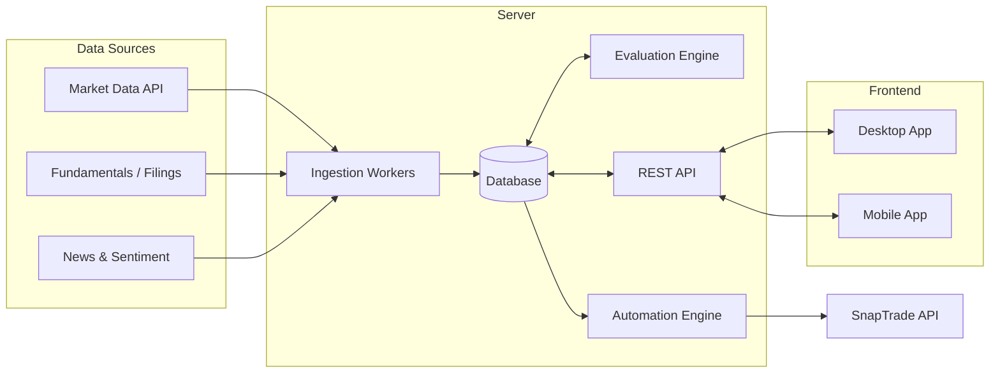

<p style="display: flex; place-items: center; gap: 2rem; font-weight: bold; font-size: 24px;">
    
    Vestlly
</p>

**Automated stock evaluation and trade execution, with desktop and mobile apps for monitoring.**

Vestlly pulls market and fundamentals data, scores securities against configurable strategies, and runs automations based on the results. A server does the heavy lifting; the desktop and mobile apps are lightweight clients for monitoring and control.

---

## Table of Contents

- [Architecture](#architecture)
- [Repository Structure](#repository-structure)
- [Server](#server)
- [Desktop App](#desktop-app)
- [Mobile App](#mobile-app)
- [Roadmap](#roadmap)

---

## Architecture



---

## Repository Structure

```
vestlly/
├── server/          # Evaluation engine, automations, API, data scrapers
├── desktop/         # Desktop monitoring app
├── mobile/          # Mobile monitoring app
```

---

## Server

The server is the core of the platform. It ingests data, evaluates securities, runs automations, and exposes an API to the monitoring apps.

### Responsibilities

| Component | Description |
|-----------|-------------|
| **Ingestion workers** | Scheduled jobs that pull prices, fundamentals, and news into the database. |
| **Evaluation engine** | Scores each security against a function optimized by genetic algorithms. |
| **Automation engine** | Checks signal generated by the evaluation function, then triggers alerts or orders. |
| **Execution layer** | Sends orders for execution through the SnapTrade API. |
| **API layer** | REST endpoints for clients. |
| **Scheduler** | Cron-style orchestration for ingestion and evaluation. |

### Data collection

The data comes from a few sources:

- **yfinance API**: The bulk of the information; price data, fundamentals, news article links.
- **newspaper3k API**: Pulls news article text, used for sentiment analysis
- **SnapTrade API**: Grants access to portfolio data including current positions, transaction history, and order statuses.

### Evaluation Strategies

The evaluation function is continuously tailored to customizable baskets of securities. The function is optimized for these securities using `genetic algorithms` and returns a buy/hold/sell signal along with a confidence score in the range [-1,1].

- **Valuation:** P/E, P/B, EPS, PEG, etc.
- **Quality:** ROE, margins, debt ratios, free cash flow
- **Momentum:** moving averages, relative strength, volume trends
- **Sentiment:** news sentiment signals

Composite scores are a weighted blend of strategies; these weights are run through a second round of genetic algorithms for another layer of optimization.

### Automations

Rules can be applied to individual accounts and their conditions can be modified at any time. Select which trained baskets are included in the selection pool. Trigger conditions default to signals derived from the evaluation function trained on those baskets. The general form of an automation flow path is

- Schedule trigger (i.e. 30 mins after market open)
- Evaluation function executed on all the securities in the selection pool
- Orders are entered for actionable signals (e.g. buy/sell)

### Tech Stack

Python, SnapTrade, yfinance, newspaper3k, MySQL.

---

## Desktop App

A full-featured monitoring dashboard for use at your desk, designed for multi-panel, data-dense viewing. It also allows you to control automations and other settings such as account connection.

### Features

- **Live dashboard:** watchlist, portfolio value, daily P&L, and market overview
- **Security detail view:** score breakdown, charts, fundamentals, and news
- **Strategy and automation manager:** create, edit, enable, and disable rules
- **Backtesting view:** replay strategies against historical data
- **Order and audit log:** filterable history of every decision and trade
- **Alerts center:** all notifications with acknowledge/snooze
- **System tray:** persistent connection status with native desktop notifications
- **Kill switch:** always visible in the toolbar

### Tech Stack

Electron, React + TypeScript, Recharts, FastAPI w/ yfinance.

---

## Mobile App

A streamlined companion app for monitoring on the go, focused on high-level portfolio data such as performance and transaction history. The mobile app offers little control over automation settings.

### Features

- **Push notifications:** executed orders, system errors, etc.
- **Portfolio snapshot:** value, day change, transaction history
- **Watchlist:** scores and price changes at a glance
- **Automation controls:** pause or resume individual automations
- **Order approval (optional):** require manual confirmation from your phone before live orders execute
- **Kill switch:** one tap to halt all automated trading

### Tech Stack (suggested)

Flutter, Dart.


## Roadmap

- [ ] Finish MVP (i.e. the contents of this readme)
- [ ] Macro-economic ETF evaluation strategies
- [ ] Automate iron butterflies on 0DTE index options
